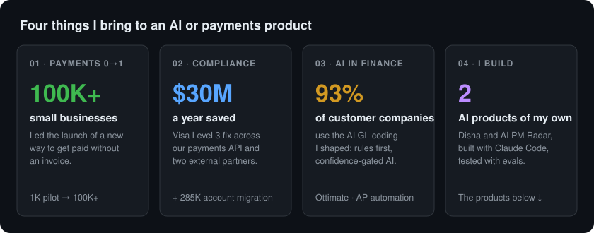

# Hi, I'm Swapnil 👋

### Product manager for AI and payments. I've shipped money movement at scale, and now I build AI products myself.

---

I work on AI-driven accounts-payable automation: document extraction, GL coding, vendor and item matching, an LLM copilot and agent prototypes. Before that I spent years in small-business payments at a global accounting platform, where I led a 0-to-1 payments launch and ran payments compliance. The thread through all of it: products where money moves and where automation has to be trustworthy.

What I've learned is that the hard part of AI isn't the model. It's deciding what the machine is allowed to say and do, and proving it stays inside those lines. Both products below are built around that.

## The products, and how I thought about each one

Both are mine, built end to end with AI coding assistants. Each repo carries the product thinking, not just the code.

| Product | What it does, and the decisions behind it |
| --- | --- |
| **[Disha (दिशा)](https://github.com/swapnilpatil2025ai/disha)**   *in development* | Helps students in Maharashtra find every scholarship they qualify for after 12th, and exactly how to apply, in English or Marathi. Built for students who are often the first in their family to go to college, and for the teachers and NGO workers who guide them.    The core call: **rules decide eligibility, AI only explains it.** Eligibility is plain code checked against verified scheme data, so it's testable; the assistant answers follow-ups from that data alone and says "I don't know" otherwise. **[The evals](https://github.com/swapnilpatil2025ai/disha/blob/main/evals/results.md)** throw tricky cases at it — a made-up scheme, a prompt injection, a student pasting their Aadhaar number, a question in Marathi — and it passes all 10. No accounts and nothing stored, because caste and income are sensitive and many users are minors. **[Product plan →](https://github.com/swapnilpatil2025ai/disha/blob/main/docs/product-plan.md)** |
| **[AI PM Radar](https://github.com/swapnilpatil2025ai/ai-pm-radar)**   *live link coming* | A twice-weekly briefing on what changed in AI, written for product managers: a two-line summary and a "For PMs" takeaway per story, with specs, detail and sources one tap away.    It runs itself at zero cost: a scheduled job collects ~150 candidate posts, an LLM ranks them for an AI PM and writes structured briefs, and the site redeploys on each commit. Two decisions I'd point to: **the model can only cite articles it actually fetched** — the code builds the links, not the model — and **a thin provider layer** lets it run on Gemini's free tier or switch to Claude with one setting. **[How it works →](https://github.com/swapnilpatil2025ai/ai-pm-radar#product-decisions)** |

## The numbers behind my roles

A 0-to-1 payments launch, scaled from a 1K pilot to 100K+ small businesses. ~$30M a year saved through card-network compliance. AI GL coding switched on for 93% of customer companies.

<b>📄 In more detail</b>

 

**AI accounts-payable automation (current role)**

- Shaped AI GL coding adopted by 93% of customer companies: deterministic rules first, AI as fallback, confidence-gated *suggest* versus *auto-apply*, and per-line provenance so we can tell AI coding from rule and human coding
- Benchmarked an LLM offline for the cold-start case where a customer's history is thin: 81% line-level accuracy at a fraction of a cent per invoice. Not in production; I defined the shadow → suggest → auto-apply path it would need
- Chose explainable robust statistics over ML-first for invoice risk scoring because fraud labels were sparse and reviewers need to see *why* something is flagged. Rolled out to over a thousand customer accounts
- Drove quality and adoption of an LLM copilot while guard-validation failures fell ~40%; defined a task-based eval framework (tool-call correctness, permission compliance, grounding)
- Prototyped an approval agent: least-privilege tools, mandatory human confirmation, server-side authorization, full audit trail

**Small-business payments, global accounting platform**

- Led the 0-to-1 launch of an invoice-free way for small businesses to get paid: piloted with 1K customers, then scaled to 100K+
- Delivered card-network (Level 3) compliance across our payments stack and two external processing partners, saving ~$30M a year
- Ran a partner-driven migration of 285K bank-linked accounts to compliant data access, protecting revenue at risk
- Moved identity from role- to attribute-based access control across three product lines

**Offline-first health marketplace, emerging markets**

- Scaled from 320K to 1M+ users across India, Kenya and Indonesia; GMV +432%
- Built a data-validation framework that took good profiles from 80% to 96%

## What I'm looking for

AI PM, Fintech/Payments PM or Technical PM roles where the work is putting AI into places money moves, safely. Based in Pune.

- 💼 **[LinkedIn](https://www.linkedin.com/in/swapnil-patil-iiml16/)** — fastest way to reach me
- 📧 swapnil.patil [at] iiml [dot] org

## How I build

I build with AI coding assistants, mainly Claude Code, and I treat them the way I'd treat a team: a written product plan first, tests before features, and evals that try to break the AI before a user does. Disha has hand-worked student profiles with known correct answers and an automatically graded set of trick questions; AI PM Radar has an offline pipeline test that runs without an API key. Where a product has to be free to run, it runs on free tiers end to end.

## What I build with

**AI**

**Build**

---

Last updated: 2026-11
